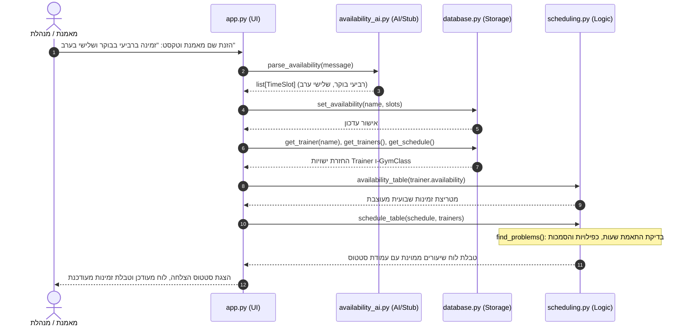

# חלוקת ה-MVP למודולים (Module Architecture Design)

מסמך זה מגדיר את הארכיטקטורה וחלוקת הקוד למודולים עבור גרסת ה-MVP של מערכת השיבוץ והניהול למכון כושר, על בסיס [design/mvp.md](file:///C:/Users/מנחם/Documents/Avital/BSC/YearD/SA/MAI/gym-scheduler/design/mvp.md) ו-[design/scenarios.md](file:///C:/Users/מנחם/Documents/Avital/BSC/YearD/SA/MAI/gym-scheduler/design/scenarios.md).

---

## 1. עקרונות התכנון המנחים
1. **אחריות יחידה (Single Responsibility Principle - SRP):** כל מודול אחראי על תחום תוכן אחד וברור, וקיימת רק סיבה אחת לשנות אותו.
2. **הפרדה חדה בין קוד דטרמיניסטי ל-AI:** חוקים לוגיים, שמירת נתונים ובדיקות קונפליקטים מנוהלים בקוד רגיל מדויק. רכיבי ה-AI מבודדים למשימות שפה טבעית בלבד.
3. **בידוד שכבת הנתונים (Data Encapsulation):** שאר המערכת ניגשת לנתונים דרך ממשק פונקציות מוגדר, ללא תלות באופן האחסון (זיכרון, JSON או מסד נתונים).
4. **עצמאות שכבת הממשק (UI Decoupling):** שכבת התצוגה אינה מבצעת חישובים לוגיים ואינה שומרת מידע, אלא רק מציגה ומעבירה אירועים.

---

## 2. פירוט המודולים ותחומי האחריות

להלן חלוקת המערכת ל-6 מודולים ממוקדים:

| מודול | שם הקובץ המיועד | תחום אחריות מרכזי (Single Responsibility) | שייך לתרחיש 1? |
| :--- | :--- | :--- | :---: |
| **טיפוסי נתונים** | `models.py` | הגדרת מבני הנתונים והישויות המשותפות במערכת (Data Classes & Constants). | **כן** (משתתף) |
| **מסד נתונים** | `database.py` | ניהול מצב המערכת, שמירה ושליפה של ישויות (In-Memory Repository / State). | **כן** (משתתף) |
| **פענוח זמינות (AI)** | `availability_ai.py` | המרת הודעות טקסט חופשי של מאמנת למשבצות זמן מובנות (`list[TimeSlot]`). | **כן** (משתתף) |
| **מנוע שיבוץ ובדיקות** | `scheduling.py` | בדיקת תקינות לוגית וקונפליקטים בלוח השיעורים, והכנת נתוני טבלאות לתצוגה. | **כן** (משתתף) |
| **ממשק משתמש** | `app.py` | שכבת התצוגה (Gradio), קליטת קלט מהמשתמשת ותזמור האירועים בין המודולים. | **כן** (משתתף) |
| **תחקור משובים (AI/RAG)**| `feedback_ai.py` | מענה על שאלות הנהלה באמצעות RAG מתוך משובי מתאמנות (חלק ב' של ה-MVP). | **לא** (תרחיש 3) |

---

### פירוט מעמיק לכל מודול:

### 1. מודול מודלים (`models.py`)
* **תחום אחריות:** הגדרת הטיפוסים והקבועים של המערכת. מודול טהור (Pure Types) שאינו תלוי באף מודול אחר.
* **ישויות מרכזיות:**
  * `TimeSlot`: יום בשבוע וחלק ביום (למשל: יום רביעי, בוקר).
  * `Trainer`: שם המאמנת, רשימת שיעורים שהיא מוסמכת להעביר, וקבוצת משבצות זמינות שבועית (`set[TimeSlot]`).
  * `GymClass`: שיעור בלוח (שם השיעור, משבצת זמן, שעה, שם המאמנת המשובצת).
  * `Feedback` *(עבור שלב ב')*: משוב מתאמנת (מזהה, תאריך, סוג שיעור, טקסט המשוב).
  * קבועים: `DAYS` (ימות השבוע א'-ו'), `PARTS_OF_DAY` (בוקר, צהריים, ערב).
* **למה הוא נפרד?** מהווה מקור אמת יחיד (Single Source of Truth) למבני הנתונים, ומונע תלויות מעגליות (Circular Dependencies).

---

### 2. מודול מסד נתונים (`database.py`)
* **תחום אחריות:** אחסון, עדכון ושליפה של נתוני המערכת.
* **ממשק פונקציות מרכזי:**
  * `get_trainer(name)` / `get_trainers()` / `get_trainer_names()`: שליפת מאמנות.
  * `set_availability(name, slots)`: עדכון מלא של משבצות הזמינות עבור מאמנת.
  * `get_schedule()`: שליפת רשימת כל השיעורים המתוכננים.
  * `get_feedbacks()` *(עבור שלב ב')*: שליפת משובי מתאמנות.
* **מימוש ב-MVP:** מאגר נתונים בזיכרון (In-Memory Dictionaries) עם נתוני דוגמה ראשוניים.
* **למה הוא נפרד?** הסתרת מנגנון האחסון (Encapsulation). במידה ונעבור בעתיד מקובץ בזיכרון למסד נתונים אמיתי (כגון SQLite או PostgreSQL), אך ורק מודול זה ישתנה, מבלי לגעת בשאר המערכת.

---

### 3. מודול בינה מלאכותית לקליטת זמינות (`availability_ai.py`)
* **תחום אחריות:** גשר בין שפה טבעית בלתי מובנית למבנה נתונים מובנה של זמינות.
* **ממשק פונקציות מרכזי:**
  * `parse_availability(message: str) -> list[TimeSlot]`: מקבלת מחרוזת טקסט חופשית של מאמנת ומחזירה רשימת אובייקטים מובנים מסוג `TimeSlot`.
* **שלבי המימוש:**
  * *שלב ראשון (סטאב/דמה):* זיהוי מילות מפתח קבועות מתוך הטקסט (ימים וחלקי יום).
  * *שלב AI:* החלפת המימוש הפנימי בקריאת LLM עם פלט מובנה (Structured Output / Tool Calling) שמבטיח פענוח גמיש ומדויק של כל ניסוח בשפה חופשית.
* **למה הוא נפרד?** בידוד מלא של רכיב ה-AI. המודול אינו ניגש ישירות למסד הנתונים ואינו מטפל בתצוגה. ניתן לבדוק אותו בקלות בבדיקות יחידה (Unit Tests) ולהחליף מודלים ללא השפעה על שאר הקוד.

---

### 4. מודול מנוע שיבוץ ובדיקות (`scheduling.py`)
* **תחום אחריות:** לוגיקה עסקית דטרמיניסטית וכללי שיבוץ (Business Rules Engine).
* **ממשק פונקציות מרכזי:**
  * `find_problems(schedule, trainers) -> dict[int, str]`: סורק את לוח השיעורים ומאתר קונפליקטים:
    1. מאמנת שאינה קיימת במערכת.
    2. מאמנת שאינה זמינה במשבצת הזמן של השיעור.
    3. מאמנת המשובצת לשיעור שהיא אינה מוסמכת להעביר.
    4. כפל שיבוץ: מאמנת המשובצת לשני שיעורים שונים באותה שעה בדיוק.
  * `schedule_table(schedule, trainers) -> list[list[str]]`: מפיק טבלה שבועית ממוינת לפי יום ושעה, הכוללת עמודת סטטוס ("תקין" או תיאור הבעיה).
  * `availability_table(slots) -> list[list[str]]`: מפיק מטריצת זמינות שבועית למאמנת (חלקי יום מול ימות השבוע, עם סימון V במשבצות זמינות).
* **למה הוא נפרד?** כללי השיבוץ הם עניין מתמטי-לוגי מדויק שחייב להיות אמין ב-100% ולא להסתמך על הזיות של AI. הפרדת המודול מאפשרת להרחיב אותו בעתיד לאלגוריתמי אופטימיזציה מלאים.

---

### 5. מודול ממשק משתמש ותזמור (`app.py`)
* **תחום אחריות:** הצגת הממשק הגרפי (Gradio), טיפול באינטראקציות משתמש ותזמור זרימת הנתונים בין המודולים.
* **רכיבים מרכזיים:**
  * תיבת בחירת מאמנת (Dropdown).
  * שדה קלט טקסטואלי להודעת זמינות חופשית וכפתור עדכון.
  * טבלת תצוגה של הזמינות האישית של המאמנת הנבחרת.
  * טבלת תצוגה של לוח השיעורים השבועי עם עמודת סטטוס קונפליקטים.
  * פונקציות תגובה לאירועים (Event Callbacks): הפעלת שרשרת הפעולות בעת לחיצה על כפתור או שינוי בחירה.
* **למה הוא נפרד?** שכבת התצוגה משתנה לעיתים תכופות (שינויי עיצוב, רכיבים וסגנון). שמירה עליה כמודול תזמור בלבד מונעת זליגת לוגיקה עסקית לממשק.

---

### 6. מודול תחקור משובי מתאמנות (`feedback_ai.py`) – *שלב ב' של ה-MVP*
* **תחום אחריות:** יישום מנגנון RAG (Retrieval-Augmented Generation) עבור מנהלת המכון.
* **ממשק פונקציות מרכזי:**
  * `ask_feedback_insights(query: str) -> str`: מקבל שאלה חופשית של המנהלת, מאחזר משובים רלוונטיים ומחזיר סיכום מנומק.
* **שייכות:** אינו משתתף בתרחיש 1 (שייך לתרחיש 3 של ה-MVP).

---

## 3. סימון המודולים המשתתפים בתרחיש הראשון

בתרחיש 1 (*"עדכון זמינות מאמנת בשפה טבעית ועדכון הלוח"*), משתתפים **חמישה מתוך ששת המודולים**:

```
[ app.py ]              --> פעיל (ממשק קלט ותצוגת תוצאות)
[ availability_ai.py ]  --> פעיל (פענוח שפה טבעית)
[ database.py ]         --> פעיל (שמירת הזמינות ושליפת מצב קיים)
[ scheduling.py ]       --> פעיל (חישוב קונפליקטים ועיבוד טבלאות)
[ models.py ]           --> פעיל (הגדרת הטיפוסים העוברים בין המודולים)
----------------------------------------------------------------------
[ feedback_ai.py ]      --> אינו משתתף בתרחיש 1 (רכיב RAG לתרחיש 3 בלבד)
```

---

## 4. מעבר המידע צעד-אחר-צעד בתרחיש הראשון (Data Flow)

להלן פירוט מדויק של זרימת המידע בין המודולים במהלך ביצוע תרחיש 1:

```
  +--------------+               +----------------------+
  |    User      |               | availability_ai.py   |
  |  (מאמנת/מנהלת)|               |     (LLM / Stub)     |
  +-------+------+               +----------+-----------+
          |                                 ^
   (1) הזנת טקסט                            | (2) parse_availability(message)
          v                                 v (3) מחזיר list[TimeSlot]
  +-------+------+   (4) set_availability  +----------------------+
  |    app.py    | ----------------------> |    database.py       |
  |   (Gradio)   | <---------------------- |     (Storage)        |
  +-------+------+   (5) get_trainers,     +----------------------+
          |              get_schedule
          |
          | (6) schedule_table(schedule, trainers)
          |     availability_table(trainer.availability)
          v
  +-------+------+
  | scheduling.py| (7) find_problems + עיבוד טבלאות
  |   (Logic)    | ---> (8) החזרת נתוני תצוגה ל-app
  +--------------+
          |
          v
   (9) עדכון המסך למשתמשת
```

### שלבי התהליך:
1. **קלט משתמשת (`User -> app.py`):**
   * המשתמשת בוחרת מאמנת (למשל: `"נועה"`) ומקלידה הודעת זמינות חופשית: `"זמינה ברביעי בבוקר ושלישי בערב"`.
   * המשתמשת לוחצת על כפתור `"עדכני זמינות"`.

2. **קריאה לפענוח שפה טבעית (`app.py -> availability_ai.py`):**
   * מודול `app.py` לוכד את האירוע ומעביר את מחרוזת הטקסט החופשי (`message: str`) לפונקציה `parse_availability`.

3. **חילוץ ישויות מובנות (`availability_ai.py -> app.py`):**
   * מודול ה-AI מנתח את המשפט ומחלץ מתוכו רשימת מופעים מובנים של טיפוס `TimeSlot` (המוגדר ב-`models.py`):
     ```python
     [TimeSlot(day="רביעי", part="בוקר"), TimeSlot(day="שלישי", part="ערב")]
     ```
   * הרשימה מוחזרת אל `app.py`.

4. **עדכון בסיס הנתונים (`app.py -> database.py`):**
   * `app.py` בודק האם חולצו משבצות תקינות.
   * אם כן, הוא מפעיל את `database.set_availability("נועה", slots)` עם שם המאמנת ורשימת המשבצות.
   * מודול `database.py` מעדכן את האובייקט של המאמנת בזיכרון.

5. **שליפת נתוני מערכת עדכניים (`app.py -> database.py`):**
   * כדי לרענן את המסך, `app.py` פונה ל-`database.py` ושולף:
     * את אובייקט המאמנת המעודכן (`database.get_trainer("נועה")`).
     * את רשימת כלל המאמנות במכון (`database.get_trainers()`).
     * את לוח השיעורים השבועי הקיים (`database.get_schedule()`).

6. **חישוב קונפליקטים ועיצוב תצוגה (`app.py -> scheduling.py`):**
   * `app.py` מעביר את הנתונים העדכניים למודול `scheduling.py`:
     * קורא ל-`availability_table(trainer.availability)` להפקת מטריצת זמינות המאמנת.
     * קורא ל-`schedule_table(schedule, trainers)` להפקת לוח השיעורים המעודכן.

7. **הרצת לוגיקה דטרמיניסטית (`scheduling.py` פנימי):**
   * פונקציית `schedule_table` מפעילה את `find_problems(schedule, trainers)`.
   * המנוע בודק כל שיעור בלוח מול הזמינות החדשה של המאמנות.
   * שיעורים שהמאמנת שלהם כבר אינה זמינה בהם יסומנו עם תקלה (`"המאמנת לא זמינה בזמן הזה"`), ושיעורים שהיו לא תקינים וכעת המאמנת זמינה בהם – יקבלו סטטוס `"תקין"`.
   * הטבלאות ממוינות ומעוצבות כרשימות ערכים המוכנות להצגה ברכיב Dataframe של Gradio.

8. **החזרת תוצרי תצוגה (`scheduling.py -> app.py`):**
   * `scheduling.py` מחזיר ל-`app.py` את שתי הטבלאות המעובדות.

9. **רינדור ועדכון מסך (`app.py -> User`):**
   * `app.py` מעדכן שלושה רכיבי ממשק במקביל:
     1. שדה הודעת סטטוס: `"הזמינות של נועה עודכנה (2 משבצות)."`
     2. טבלת זמינות שבועית: סימון V במשבצות רביעי-בוקר ושלישי-ערב.
     3. טבלת לוח שיעורים שבועי: לוח מעודכן עם סטטוסי תקינות עכשוויים.

---

## 5. תרשים זרימה (Sequence Diagram)



---

## 6. סיכום תאימות לארכיטקטורת המערכת
החלוקה המוצעת מבטיחה:
* **בדיקות קלות (Testability):** ניתן לבדוק את `scheduling.py` ואת `availability_ai.py` בצורה מבודדת ללא ממשק גרפי וללא תלות ברשת.
* **מעבר הדרגתי ל-AI:** פיתוח המערכת מתחיל עם סטאב ב-`availability_ai.py`, ומאפשר החלפה חלקה ל-LLM מבלי לשנות אף שורת קוד ב-`app.py` או ב-`database.py`.
* **הרחבה עתידית:** תוספת רכיב ה-RAG (מודול `feedback_ai.py`) משתלבת באופן טבעי במבנה הקיים מבלי לשבור את מודולי הזמינות והשיבוץ.
